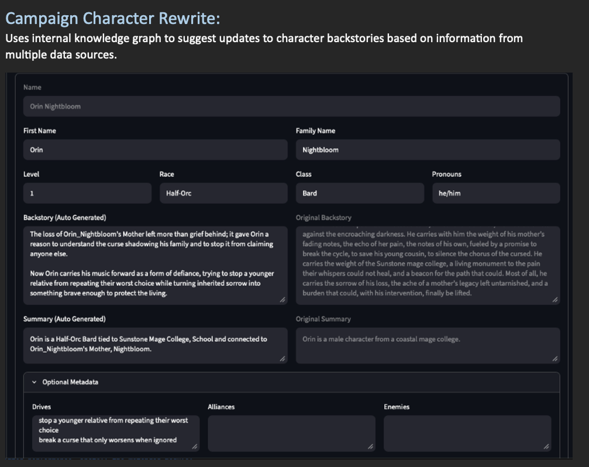
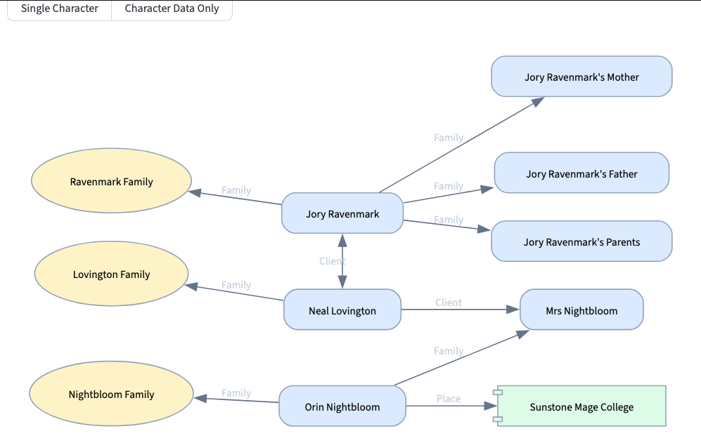
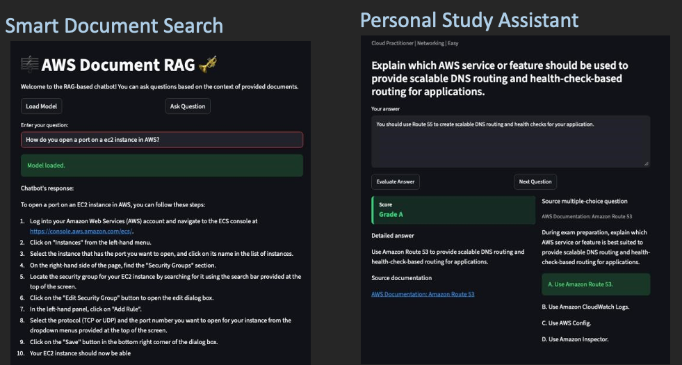

# Data Engineer & Cloud Developer

Software engineer with 6+ years of experience working in AWS environments and data systems. Built financial data pipelines, distributed validation frameworks, and serverless monitoring services, with recent projects in machine learning and language model applications.

🔗 [Deployed Models](https://huggingface.co/DanielLevenstein)
🔗 [Kaggle Notebooks](https://www.kaggle.com/daniellevenstein)

## Career Highlights:

- Built Java and Scala Spark pipelines for large-scale financial data ingestion using Kafka workflows across AWS. (FINRA)
- Developed distributed frameworks to validate AWS Step Functions workflows spanning multiple microservices. (FINRA)
- Developed AWS Lambda monitoring services to detect healthcare pipeline failures in near real time, surfacing issues before downstream impact. (b.well Connected Health)

### Technical Skills

- **Languages:** Python, Java, Scala
- **Application development:** Streamlit, Docker, AWS Lambda, JSON data workflows
- **Data and AI:** ETL pipelines, vector search, local language models, TensorFlow, Keras, OpenCV

### Deployed Projects:

- [TicTacTaire](https://tictactaire.onrender.com/): Delivered a custom solitaire web application for a local game designer, deployed on Render.
- [AWS Certification Coach](https://aws-certification-coach-latest.onrender.com/): Built and deployed an application that evaluates freeform answers to AWS certification practice questions.

### Certifications:

- Certified AWS Cloud Practitioner (AWS, 2025)
- Post-Graduate Certificate in Artificial Intelligence & Machine Learning (UT, 2026)

## Featured Projects:

*Figure: Shows the original backstory of a character with a cleaned-up version.*

### 🎲 Campaign Knowledge Graph

🔗 GitHub: [DanielLevenstein/Campaign_Notes_Manager](https://github.com/DanielLevenstein/Campaign_Notes_Manager)

**Languages:** Python

**Overview:**
Built an application for managing tabletop campaign characters and session notes. It imports text and Markdown files, visualizes character relationships, and uses a local language model to refine backstories.

**Key Features:**

- Use a local language model to clean up character summaries and backstories.
- Import session notes from external data sources extracting heading and date information.
- Generate a knowledge graph from multiple data import sources and display information to users in clean readable format.

**Tools & Technologies:** Streamlit, LangChain, LangGraph, Graphviz, Machine Learning

*Figure: Displays generated knowledge graph of main character in test campaign.*

---

### 🎓 AWS Certification Coach

🔗 GitHub: [DanielLevenstein/AWS-Certification-Coach](https://github.com/DanielLevenstein/AWS-Certification-Coach) 
🔗 Live Demo: [aws-certification-coach-onrender](https://aws-certification-coach-latest.onrender.com/)

**Languages:** Python

**Overview:** Developed an AI-powered study application for AWS certification practice. The app presents freeform AWS exam-style questions, evaluates learner answers with a trained local classifier, and returns structured coaching feedback with score, missing concepts, detailed answer guidance, and original multiple-choice provenance.

**Key Features:**

- Built a Streamlit study interface for answering AWS certification questions in freeform text.
- Generated self-authored AWS exam-style training, holdout, and sample question datasets.
- Designed a combined JSON artifact format that stores questions, original multiple-choice provenance, correct answers, wrong answers, and partial-credit examples together.
- Trained a local answer classifier to evaluate full-answer correctness with release metrics for accuracy, precision, recall, and confusion matrix results.
- Created a partial-credit regression model using continuous answer ratings and mean-squared error evaluation.
- Added validation tests for classifier behavior, low-credit answer rejection, memory overhead, generated artifacts, and model performance.
- Containerized the application with Docker for local deployment and Render-ready hosting.

**Tools & Technologies:** Streamlit, Docker, Machine Learning, ML Evaluation, Classification Models, Regression Models, JSON Data Pipelines, Automated Testing, AWS Certification Content

---

### 🎺 AWS Documentation RAG System

🔗 [GitHub: AWS-Documentation-Rag](https://github.com/DanielLevenstein/aws-documentation-rag)

**Languages:** Python

**Overview:**
Developed a retrieval-augmented generation (RAG) application for querying AWS documentation. Built a pipeline for crawling AWS documentation pages, preprocessing and storing data in a vector database, and generating technical responses using a language model through a Streamlit interface.

**Key Features:**

- Developed a web crawler for ingesting AWS documentation pages.
- Kept track of feature downloads and crawl depth to prevent redownloading files repeatedly.
- Implemented vector-based semantic retrieval for documentation search workflows.
- Integrated a language model for context-aware technical question answering.
- Built a Streamlit frontend for interactive querying and response generation.
- Containerized the application using Docker for local deployment and testing.

**Tools & Technologies:** Streamlit, Docker, Vector Databases, Vector Search, LLMs, Web Scraping, ETL Pipelines

*Figure: AWS Documentation RAG and AWS Certification Coach interfaces, side by side.*

---

### 🪖 Helmet Classification Pipeline

🔗 [Interactive Streamlit App](https://huggingface.co/spaces/DanielLevenstein/Helmet_CNN_Data_Quality_Case_Study) 
🔗 [Helmet CNN Training Notebooks](https://github.com/DanielLevenstein/Helmet_CNN_Model_Training_Notebooks)

**Languages:** Python

**Overview:**
Developed an image classification pipeline for helmet detection using a CNN trained on standardized 100x100 image inputs. Built a data curation workflow to transform raw annotation images into standardized size and remove samples with too low a resolution to be useful.

**Key Features:**

- Built four CNN-based image classification models using four different training datasets.
- Evaluated models based on a holdout dataset consisted of equal numbers of samples from Dataset2, and Dataset3.
- Improved accuracy of a classification model from 77% to 94%, and calculated precision, recall, and F1 metrics for each model.
- Identified categories of images model struggles with for further fine-tuning.

**Tools & Technologies:** TensorFlow, Keras, OpenCV, Streamlit, Hugging Face, CNN, Training Data Curation

---

### 🍕 FoodHub – Delivery Data Analysis

🔗 [GitHub: FoodHub Data Analysis](https://github.com/DanielLevenstein/FoodHub_UT_ML_Project1)

**Languages:** Python

**Overview:**
Developed discount program for a food delivery app, which reaches up to 12% of the population under model conditions.

**Key Features:**

- Cleaned dataset and imputed missing ratings.
- Identified top-rated restaurants by cuisine.
- Calculated discount cost vs. total customer reach.

**Tools & Technologies:** Data Visualization, scikit-learn

*Figure: Discount cost vs total reach with value per customer analysis.*

---

### 💪 Stress vs. Physical Activity – Kaggle Data Analysis

🔗 [Kaggle: Stress vs Physical Activity Correlation](https://www.kaggle.com/code/daniellevenstein/stress-vs-physical-activity-correlation)

**Languages:** Python

**Overview:**
Analyzed relationships between stress levels and physical activity using real-world survey data.

**Key Features:**

- Performed exploratory data analysis and correlation studies
- Generated three population clusters using K-Means
- Identified occupation-based stress correlations
- Visualized cluster separation and activity distribution

**Tools & Technologies:** Data Visualization, scikit-learn

*Figure: K-means clustering reveals distinct population-level groups based on total activity and stress.*

---

### ⚫ Reversi Game Engine

🔗 [GitHub: Reversi Game Engine](https://github.com/DanielLevenstein/reversi-game-engine) 
🔗 [GitHub: Reversi Frontend](https://github.com/DanielLevenstein/reversi-front-end)

**Languages:** Scala, JavaScript

**Overview:**
Developed a Reversi (Othello) game engine in Scala with a REST API and a Minimax AI opponent. The backend is paired with an AI-generated JavaScript frontend. The project is ready for deployment but is not publicly hosted.

**Key Features:**

- Implemented Reversi game logic and move validation.
- Built a Minimax AI with alpha-beta pruning, customizable heuristics, and evaluation caching.
- Exposed REST endpoints for creating games, retrieving board state and valid moves, and applying human or AI moves.
- Provided Docker-based backend setup and a separate Vite frontend for local play.

**Tools & Technologies:** Play Framework, SBT, REST APIs, Docker, Node.js, Vite, Minimax, Alpha-Beta Pruning

## 📫 Contact

Phone: 512-885-5925
LinkedIn: https://www.linkedin.com/in/daniel-aaron-levenstein/
